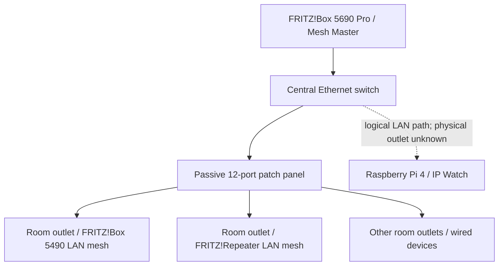

# IP Watch — Home Network Monitoring Roadmap

**Status:** Phases 1 and 2 implemented locally · Pi release candidate passed an emulated ARM64 smoke · 2026-11-27

## 1. Instructions for Codex

Extend the existing IP Watch repository; do not replace it with a new application. Read `AGENTS.md` and its prescribed documentation sequence before editing. Follow existing conventions, preserve the mobile-first PWA and existing device monitoring. Maintainer documentation and comments must be in English. Place this active plan in `docs/plan/NETWORK_MONITORING_ROADMAP.md` (repository convention). Work in small, reviewable phases; present findings, scope, risks and acceptance criteria before implementation. Do not deploy, remove services, change router settings or perform destructive operations without explicit approval. Do not assume hardware capabilities or invent live data. Start with Phase 0 only.

## 2. Discovery / current state

### Product goal

Turn IP Watch into a local home network inventory and monitoring application: show the FRITZ! mesh, physical switch ports, passive patch panel, room outlets, connected devices and measured traffic where available. Retain the original reachability monitoring (original motivation: PlayStations and phones). Reachability is not evidence of active use or data transfer.

### Confirmed repository baseline (provided ZIP, static inspection)

- `frontend/`: Angular 21.2, standalone components, Tailwind 3.4, RxJS, PWA/service worker; existing dashboard and health routes.
- `frontend/src/app/models/device.ts`: tracked device model with PS5/PC/TV types, IP, probe configuration and reachability status.
- `frontend/src/app/services/device-store.service.ts`: browser IndexedDB (`ip-watch-db`, version 1), memory fallback; preserve existing records and settings. `probe-api.service.ts` handles probe communication.
- `probe-host/src/server.js`: Node.js / Express 4.21.2; existing `GET /api/health`, `GET /api/status`, `POST /api/status/check-now`. ICMP and optional HTTP(S) probes. Optional `PROBE_API_TOKEN`; health endpoint exempt per README.
- `deploy/`: native Nginx/systemd installation and update, backup/restore and verification scripts; Docker Compose for local integration. Existing native production deployment should remain supported.
- `docs/`: architecture/API/coding/deployment conventions; active plans belong in `docs/plan/`.
- No FRITZ! or SNMP integration was identified in the inspected baseline. Reconfirm against the current workspace. No build or runtime tests were performed on the ZIP.

### Confirmed target environment (user shell output)

| Item | Value |
|---|---|
| Server | Raspberry Pi 4 Model B Rev 1.5, 4 GB RAM (3.7 GiB visible) |
| OS | Debian 13.2 Trixie, aarch64 / 64-bit |
| Storage | 64 GB microSD, 38 GiB available at inspection |
| LAN | 192.168.16.30/24 via eth0; DHCP gateway 192.168.16.1 |
| Router | FRITZ!Box 5690 Pro, FRITZ!OS 8.51, mesh master |
| Runtime | Node 20.20.0, npm 10.8.2; Python 3.13.5; Docker absent |
| Web | Nginx port 80, root `/var/www/ip-watch`, `/api/` proxied to localhost:3001 |
| Backend | `ip-watch-probe.service`, user/group `ipwatch`, `/opt/ip-watch/probe-host`, env `/etc/ip-watch/probe-host.env` |
| Other services | SSH, Raspberry Pi Connect, Ollama (llama3 model), LightDM, CUPS; leave unchanged |

TR-064 descriptor `http://192.168.16.1:49000/tr64desc.xml` returned XML identifying the router. Authenticated calls and available mesh actions have not yet been verified. Existing service unit on the Pi differs from the archived template (template includes `ReadWritePaths=/var/lib/ip-watch`); inspect before deployment. The Pi previously had an abandoned PV battery project; do not erase it or other files without approval. No reinstall is required at present. Reserve its DHCP address in the router if the owner approves.

### Physical network / target topology

Current switch: existing 8-port unit, likely TP-Link TL-SG108, exact model/revision unverified. Planned replacement: D-Link DGS-1100-16V2/E, 16 Gigabit ports, candidate only, not purchased or tested. [Candidate at Office Partner](https://www.office-partner.de/d-link-dgs-1100-16v2/e-16-port-managed-layer2-smart-gigabit-switch-n2008252075-5136052647). Confirm exact revision, SNMP support and required MIBs against vendor documentation before purchase. No rack; desktop/fanless preferred. 1 Gbit/s per port sufficient; no PoE or multi-gig requirement. Cable marking possibly Cat 6e (not a standardized category); no cable capability assumption. With 16 ports, 12 patch connections and one router uplink leave three ports, or two if Pi is connected directly. Actual patching, room names, outlet labels and repeater model are unknown.

## 3. Decisions and scope

- Retain Angular + Node/Express + native Nginx/systemd. No Python rewrite, mandatory Docker, cloud service or subscription.
- Add server-side integration adapters and shared persistent inventory. SQLite is proposed; select a maintained Node-compatible driver after checking ARM64 and runtime compatibility. Keep existing IndexedDB data intact; no silent migration or reseeding.
- Read-only router/switch integration. Local inventory edits are permitted; no router/switch configuration writes, port shutdown, traffic blocking or parental-control automation.
- FRITZ!OS native mesh view cannot be assumed extensible; build a separate IP Watch dashboard, not an injected FRITZ!OS UI.
- Use source attribution, timestamps and confidence for observed relationships. Distinguish unknown, stale, unavailable, offline, link down, unpatched and unassigned. Never equate these states.
- No real-time per-device traffic promise: SNMP port counters aggregate all traffic behind a port, including mesh clients. FRITZ! device list does not prove per-device traffic. Only show per-device rates if a validated source provides them. No packet-content capture or browsing history.

## 4. Functional requirements

| Module | Requirements |
|---|---|
| Overview | Internet/router status where supported, mesh nodes, discovered and tracked devices, active ports, integration health, last successful refresh |
| Mesh | Router, 5490 and additional repeater; wired/wireless relationships where reported; client association and link rates only if supported; mark inferred/manual edges |
| Switch | Front-panel representation of 16 ports, link/admin status, negotiated speed, counters/rates, errors and learned MAC addresses where supported |
| Patch panel | Exactly 12 numbered positions initially; edit room/outlet/label, switch-port mapping, notes and verification state; independent physical mapping and live link status |
| Devices | Merge discovered FRITZ! hosts with optional manual links to tracked devices; hostname, IP(s), MAC, source, last seen; handle changing IPs and randomized MACs; no unsafe automatic merges |
| Statistics | RX/TX rates per port, history, link transitions, bounded retention, explicit gaps and reset handling |
| Floor plan (later) | Optional owner-supplied floor plan or manually arranged rooms/outlets, clickable status markers; no invented floor plan |
| Legacy monitoring | Preserve device CRUD, probe settings, reachability checks, health diagnostics and mobile PWA |

Physical mapping workflow: identify each outlet with a numbered RJ45 cable tester on disconnected passive links (or manually observe switch LEDs with a test device); label both ends; record patch-panel port to room/outlet, then switch-port to patch-panel port. Validate duplicates; allow unpatched and spare ports. Learned MACs can suggest connected devices but cannot identify the physical room without this mapping. Multiple MACs behind a repeater/uplink are normal.

## 5. Proposed architecture and data contracts

Angular UI -> existing Nginx `/api/` -> Express backend -> independent collectors (FRITZ! TR-064, SNMP, existing probe) -> shared inventory / bounded time series store. Poll on server, not separately for each browser. Keep legacy endpoints unchanged; new versioned routes are proposals to reconcile with `docs/api.md`:

- `GET /api/v1/network/overview`, `/mesh`, `/devices`, `/integrations`
- `GET /api/v1/switches`, `/switches/:id/ports`, `/switches/:id/ports/:portId/traffic`
- `GET /api/v1/patch-panels/:id/ports`; `PUT /api/v1/patch-panels/:id/ports/:portId` for validated manual mapping

Define schemas and error handling before implementation. Use existing error conventions for new endpoints. Suggested entities: integration, network device, interface, switch, switch port (stable physical label plus ifIndex mapping), patch panel, patch port, room, outlet, patch connection, observation, traffic sample. Store manual inventory separately from transient observations; polling must never overwrite manual labels. Use UTC timestamps and distinguish observation time from last successful poll. Export/import manual inventory and include server DB in backups; legacy browser data needs separate export if desired.

### FRITZ! adapter

Discover services/actions from descriptor and SCPD. Test authenticated read-only calls for host count/list, device information and mesh topology (e.g. vendor-specific mesh-list action if advertised). Prefer validated TLS endpoint and secure credential handling; do not globally disable certificate validation. Use dedicated local FRITZ! user with minimum supported permissions (settings access may be required; not necessarily read-only at account level). No internet login. Owner creates credentials locally; never request passwords in chat or commit them. Normalize missing fields, IPv4/IPv6, duplicates and partial failures. If mesh data is unavailable, show manual topology with explicit provenance.

### SNMP adapter

Verify exact switch firmware and supported MIBs first. Prefer SNMPv3 authPriv if supported; otherwise dedicated read-only v2c community, restricted to Pi/management LAN where supported. Never use write community or expose UDP 161 externally. Probe system identity, IF-MIB (`ifOperStatus`, `ifAdminStatus`, `ifName`/`ifDescr`, `ifHighSpeed`/`ifSpeed`, `ifHCInOctets`, `ifHCOutOctets`, errors), BRIDGE-MIB/Q-BRIDGE-MIB FDB and bridge-port to ifIndex mapping, LLDP-MIB if available. Do not assume all are implemented. Use 64-bit counters where possible; compute bps = delta octets * 8 / elapsed seconds; handle wraps, reboot, discontinuity, missing samples and stale values. Never display fabricated zeros. Use mocked adapter fixtures until hardware is available; label demo mode clearly.

### Resource and security constraints

Initial proposed intervals: FRITZ! hosts/mesh 60 s, switch status/counters 30 s, FDB 60 s; configurable, bounded timeouts, backoff, no overlapping polls. Keep recent raw samples for 24 h and 5-minute aggregates for 30 days as a starting proposal; batch writes and prune to protect microSD. Measure CPU, RAM, DB growth and polling load. Use environment configuration with protected permissions, redact logs, bind backend to loopback in native deployment, avoid arbitrary user-controlled probe targets for new integrations, validate input, restrict management writes to authenticated owner. Existing optional token is not sufficient evidence of a secure deployment; inspect current auth and CORS, propose changes before rollout. No external port forwarding. Ensure PWA does not cache secrets or present stale API data as live.

## 6. Implementation sequence / acceptance gates

### Phase 0 — Workspace audit and plan (first task only)

Read repository rules/docs, inspect git status (if available), source, tests, deployment scripts, existing data handling and API auth. Verify actual Angular/Node compatibility (Node 20.20.0 may be adequate; check Angular 21.2 requirements and build environment; do not upgrade blindly). Run non-destructive baseline checks/build/tests where feasible; report failures and environment blockers. Identify changed files and dependency options, decide SQLite approach, propose integration interfaces and migration strategy. Report plan and wait for owner approval. No production access or deployment.

### Phase 1 — FRITZ! integration

Implement configurable read-only adapter, mocked fixtures, status endpoint and host inventory UI. Test auth failure, timeout, malformed response and partial data. Owner performs live validation on Pi with locally configured credentials. Acceptance: router and real discovered hosts visible with timestamps; no secrets in frontend/logs; legacy endpoints and PWA still work. Mesh topology added only when verified.

### Phase 2 — Physical inventory and UI

Add persistent room/outlet/patch/switch mapping and responsive overview. Acceptance: all 12 patch positions editable, unique mapping validation, restart persistence, export/import and explicit unknown/unpatched states; no switch required. Preserve existing tracked devices.

### Phase 3 — SNMP integration (hardware gate)

Confirm candidate switch and MIB support before purchase; implement against fixtures first if useful. After owner installs switch, verify identity, port mapping, counters and FDB on actual hardware. Acceptance: real link transitions match physical ports; speed and rates match controlled transfer within reasonable tolerance; resets and outages handled; unsupported fields labeled; multiple MACs per port supported.

### Phase 4 — Statistics and topology

Combine verified observations with manual mappings, add traffic charts, stale indicators, retention and optional floor plan. Acceptance: no misleading per-device attribution; correct repeater placement behind patch panel; bounded DB growth and responsive mobile UI.

### Phase 5 — Rollout and operations

Review native backup/update/restore scripts and systemd write permissions. Back up existing frontend, backend, config and new DB; separately protect legacy browser data. Test local build, unit/contract/integration checks and smoke tests. Owner approves deployment and rollback procedure. Keep SSH/Pi Connect functional. Verify Nginx, `/api/health`, legacy probes, new integrations, persistence after restart, PWA cache update and resource usage. Roll back on regressions. Do not stop Ollama, desktop or other services without approval.

## 7. Open decisions / risks

| Item | Status / mitigation |
|---|---|
| D-Link SNMP version/MIBs | Unverified for exact revision; purchasing gate |
| FRITZ! authenticated access / mesh actions | Descriptor reachable only; live test required |
| Physical wiring / Pi location / repeater model | Owner mapping required |
| Auth and local TLS | Review existing configuration; no silent security changes |
| SQLite driver / ARM64 | Evaluate compatibility and maintenance before adding dependency |
| Existing IndexedDB data | Preserve; migration/export only with explicit design |
| microSD wear | Bounded retention, batched writes, backup and measurement |
| Per-device traffic | Not guaranteed; port aggregates only unless validated |
| Current workspace vs ZIP | Re-audit; no assumption of identical revision |

## 8. Definition of done and reporting

For each phase: scope, decisions, files changed, tests executed and results, unresolved risks, migration/rollback notes, updated relevant docs (`README.md`, architecture/API/deployment docs as appropriate), and next approval gate. Do not claim live integration or successful deployment without evidence. Keep this roadmap updated as decisions are accepted.

## 9. Initial Codex prompt

> Read AGENTS.md and follow its read order. Read docs/plan/NETWORK_MONITORING_ROADMAP.md as the project handoff. Start with Phase 0 only: audit the existing IP Watch workspace, verify the stated baseline and runtime compatibility, identify reusable modules, run feasible non-destructive baseline checks, and propose a concrete implementation plan for Phase 1. Preserve existing functionality and data. Do not deploy, change live configuration, request secrets, or implement later phases yet. Report assumptions, blockers, test results and proposed file changes, then wait for approval.

## 10. Phase 0 workspace audit

### Repository and runtime baseline

- Audited `main` at `a34cf37`. The roadmap was already untracked when the audit began. This audit updates only this file. No Raspberry Pi, router, or switch was accessed.
- The lockfiles resolve Angular and CLI 21.2.0, TypeScript 5.9.3, RxJS 7.8.2, Tailwind 3.4.19, and Express 4.22.1. Express is the only direct backend runtime dependency. No FRITZ!, SNMP, or SQLite integration exists in the application source.
- Reuse the Express process and Nginx `/api/` forwarding, Angular routing, `HttpClient`, the app's signals and responsive styles, and the existing API token setting for IP Watch authentication. The legacy `ProbeApiService` and `DeviceStoreService` remain responsible for the existing reachability workflow. The dashboard requests probes on initialization and manual refresh. The server runs Linux `ping` and optional HTTP(S) checks and retains the last request's results in memory.
- IndexedDB `ip-watch-db` v1 stores tracked devices and their last probe results. Browser localStorage holds the seed marker and probe settings, including the optional IP Watch API token. The repository's `runtime-data/probe/devices.json` is unused by the running backend. The existing Pi backup/restore scripts copy a `devices.json` file and do not cover browser storage. Keep the current PWA origin, database, records, and settings. A later HTTP-to-HTTPS or hostname change creates a different browser origin and needs a separate preservation and validation plan.
- The backend exempts `/api/health` from optional bearer authentication and answers CORS preflight before auth. Existing routes use wildcard CORS. The native example binds the backend to loopback, while the application default binds to all interfaces. The Nginx template listens on HTTP port 80. The PWA build contains a service worker and caches app assets. Service worker operation requires a secure context, so production registration and iPhone behavior remain verification items. [Secure Contexts specification](https://www.w3.org/TR/secure-contexts/)
- The reported Pi Node 20.20.0 meets Angular 21's `^20.19.0` range. The local Node 20.11.1 falls below that minimum. The baseline ran with the installed Node 24.11.1 and npm 11.6.2. The successful Windows build verifies the local toolchain. The reported Pi runtime and ARM64 build were assessed from version requirements and owner-provided output. Node 20 is end-of-life. The Dockerfiles and native installer still reference Node 20. Propose a separate, owner-approved runtime upgrade before production activation. [Angular compatibility](https://angular.dev/reference/versions) · [Node.js release status](https://nodejs.org/en/about/previous-releases)

### Local verification

| Check | Result |
| --- | --- |
| `npm run build` in `frontend/` | Passed on Node 24.11.1 with installed dependencies. Initial bundle 402.12 kB. `ngsw-worker.js` and `ngsw.json` were generated. |
| TypeScript compilation for `frontend/tsconfig.spec.json` | Passed with `--noEmit`. |
| Karma/Jasmine | Test bundles compiled. ChromeHeadless terminated before executing the eight specs, with GPU process startup errors on Windows. A retry with temporary Chrome flags had the same result. |
| Legacy API smoke | Passed on loopback with auth disabled and with a synthetic bearer token. Covered health exemption, preflight, token enforcement, validation and duplicate IP errors, HTTP reachability via a local stub, and the status cache. Linux ICMP was outside this test. |
| Deployment checks | `node --check`, Bash syntax checks for all nine deployment scripts, and `docker compose config --quiet` passed. Docker Engine access was denied, so the full Compose/Nginx smoke was skipped. Native Linux, iPhone and Pi checks remain open. |
| SQLite feasibility | An in-memory create/insert/read/close smoke passed with the built-in `node:sqlite` on Windows Node 24.11.1, which emitted its experimental warning. ARM64 and persistent-file behavior remain to be verified. |

### Storage decision proposed for approval

Use an in-memory latest snapshot for Phase 1. Discovered hosts are read-only observations and can be fetched again after a restart. The UI shows that it is waiting for the first refresh. Phase 1 therefore adds no database, write path, browser migration, or background history. A failed poll retains any prior snapshot with its timestamp and a stale indicator.

For Phase 2, prefer `node:sqlite` on a supported Node 24 LTS patch after approval and Debian ARM64 verification. Node 24 has official Linux ARM64 builds, and `node:sqlite` is a release candidate starting with 24.15.0. Node 20 has no built-in SQLite. `better-sqlite3` is a fallback to evaluate against an exact Node ABI or N-API version, Linux ARM64/glibc, and the Docker image's libc. Its v12.10 release removed Node 20 prebuilds. Before persistent inventory is enabled, test migrations, permissions, restart behavior, and SQLite-consistent backup/restore as the service user. Keep manual inventory distinct from observations. Any import or linking of legacy tracked records needs an explicit design and owner approval. [Node SQLite API](https://nodejs.org/download/release/v24.22.2/docs/api/sqlite.html) · [Official ARM64 build](https://nodejs.org/en/blog/release/v24.22.3/) · [better-sqlite3 releases](https://github.com/WiseLibs/better-sqlite3/releases/tag/v12.10.0)

## 11. Phase 1 implementation proposal

**Scope:** A read-only FRITZ!Box snapshot and a responsive host inventory in the existing app. Physical inventory, switch polling, traffic history, device matching, and rollout are scheduled separately. Mesh capability is recorded only when advertised. Mesh rendering requires a verified live payload and remains outside the initial implementation.

1. **Document the contract and access rules.** Add `GET /api/v1/network/integrations` for sanitized FRITZ! status, capability flags, and UTC `lastAttemptAt`/`lastSuccessAt`, and `GET /api/v1/network/devices` for the router identity and its reported host snapshot. Include `source`, `observedAt`, snapshot state, and normalized host data (`hostname`, `addresses`, optional MAC, and router-reported active state or `null`). A complete empty list differs from a missing snapshot. A partial snapshot is marked explicitly. A stale snapshot retains its original observation time. Use `Cache-Control: no-store`, a `{ data: ... }` success wrapper and the documented API error object for request errors. The proposed inventory access requires the existing IP Watch bearer token when live FRITZ! integration is enabled. Both new endpoints are same-origin in the browser and receive no wildcard CORS headers. Approve these rules before coding. Keep the legacy API contracts, probe defaults and health exemption intact.
2. **Implement a server-only adapter and collector.** Make TR-064 opt-in via protected service configuration. Read the configured router's descriptor and SCPD to discover `DeviceInfo` and `Hosts` actions. Prefer the advertised host-list action and validate the returned path before fetching. Use bounded host count/entry reads only if bulk listing is unsupported and fixtures cover the fallback. Confirm the exact router's capabilities later with the owner. Use the documented HTTP Digest flow against verified TLS, with a router-specific CA if required, and a fixed set of read-only actions. Constrain descriptor, SCPD and list requests to the configured router and verified HTTPS origin for authenticated traffic. Reject cross-origin redirects, bound response size, parsing and deadlines, and verify behavior when credential or certificate checks fail. Keep credentials, raw payloads and any session identifiers out of logs and API responses. Evaluate a pinned JavaScript namespace-aware XML parser such as `saxes` for Node 20/24, maintenance and advisories before adding it. Reject DTDs and cover malformed XML with fixtures. Define the internal boundary as `collect({ signal })` returning normalized router and host observations plus capability and completeness metadata. Poll once per service at a configurable interval, proposed 60 seconds after completion, with bounded backoff, no overlapping reads, and cleanup on shutdown. Multiple browsers consume one snapshot. Keep the last usable observation on transport, auth or whole-payload failure. [FRITZ! TR-064 First Steps](https://fritz.support/resources/TR-064_First_Steps.pdf) · [FRITZ! Hosts interface](https://fritz.support/resources/TR-064_Hosts.pdf) · [saxes documentation](https://github.com/lddubeau/saxes)
3. **Add an Angular `/network` view.** Add a standalone page, a typed API service using same-origin `/api/v1/network/...`, and a navigation entry from the existing app. Render router identity, source, last successful refresh, discovered hosts, empty/disabled/loading states, partial results and stale data. Use the existing German/English UI convention. Treat the router's active flag as an observation. Keep discovered hosts separate from locally tracked devices. Keep network API responses outside service-worker storage. Where the dev server is used, forward the new same-origin requests through a local dev proxy or use the existing Nginx test topology.
4. **Verify locally and document owner validation.** Use synthetic descriptor, SCPD, SOAP and host-list fixtures plus a loopback router stub. Cover auth success/failure, timeout, invalid TLS or unexpected origin, oversized and malformed data, missing fields, IPv4/IPv6, duplicates, valid empty results, unsupported actions, and partial results. Verify polling recovery, stale timestamps, token enforcement, no sensitive data in client responses/logs, and that disabling the collector restores the legacy-only runtime. Re-run the build, existing browser tests in a working launcher, legacy API smoke, Linux/Nginx smoke and a same-origin PWA regression test with existing IndexedDB records. Prepare an owner-run validation procedure for the Pi covering authenticated read actions, sample hosts, timestamps, router certificate trust, and browser behavior. Live success requires owner-observed results and separate approval for deployment or settings changes.

### Anticipated files and acceptance

An enabled collector without an IP Watch API token or valid router configuration starts in a configuration-error state and makes no router requests. Build the host DTO from the listed fields. The FRITZ! host-list format can include mesh login URLs and tokens, so fixture tests must verify those fields are discarded. [FRITZ! Hosts interface](https://fritz.support/resources/TR-064_Hosts.pdf)

| Area | Expected changes after approval |
| --- | --- |
| Backend | `probe-host/src/server.js`, `probe-host/src/integrations/fritz/`, `probe-host/src/routes/network.js`, `probe-host/test/` and fixtures. Update the package scripts for tests. Change dependencies and lockfile only for a validated transport/parser dependency. |
| Frontend | `frontend/src/app/app.routes.ts`, the dashboard navigation, `frontend/src/app/pages/network/`, a network model/API service and targeted tests. |
| Maintainer docs | `README.md`, `docs/api.md`, `docs/architecture.md`, `docs/deployment/_deployment_base.md`, the E2E runbook and the roadmap. Add commented, non-secret example configuration to `deploy/systemd/probe-host.env.example`. |

Local acceptance requires a working production build, typed and contract-tested endpoints, a mobile-readable fixture-backed host inventory, preservation of existing devices and settings, and continued legacy probe/health/PWA behavior. Owner acceptance requires the actual router and representative hosts with observation timestamps, verified access controls and explicitly confirmed FRITZ!Box capabilities. Phase 1 rollback is to disable the integration or restore the prior application artifacts at the same origin. There is no Phase 1 data migration to reverse. Existing native update scripts replace the web root and restart services, so any production rollback and artifact backup procedure must be rehearsed before rollout.

### Open questions and approval gates

| Item | Current evidence and next decision |
| --- | --- |
| Implement Phase 1 | Owner approved the scope, in-memory snapshot, and same-origin/token access rules on 2026-11-26. |
| Router capabilities and credentials | Owner previously confirmed only the descriptor. Verify HTTPS endpoint and certificate trust, minimum account permissions, supported host-list actions, and mesh data on the exact FRITZ!OS version. Credentials stay local. |
| PWA and LAN transport | The native template serves HTTP. Owner approval is required for any change to the production access policy, TLS, Nginx, or app origin. Validate current install and service worker behavior, and protect browser data before any origin transition. |
| Runtime and regression coverage | Node 24 LTS rollout needs a separate plan and owner approval. Re-run Karma in a working browser and verify Linux ICMP, Nginx forwarding and PWA behavior before rollout. |
| Later phases | Switch revision and MIBs, physical patching and repeater model, and SQLite backup/write permissions on the Pi remain unverified. They do not block fixture-backed Phase 1 work. |

## 12. Phase 1 implementation and verification

- Shipped the opt-in Express collector and two versioned read routes, the Angular `/network` view with same-origin requests, and a local Angular development proxy. The collector uses pinned `saxes` 6.0.0 for namespace-aware XML parsing. The native environment example, API docs, architecture docs, README, and owner runbook describe activation, access, state and rollback. The feature defaults to disabled.
- Kept the collector in memory and treated `meshList` solely as advertised capability. The host payload includes only display fields. The app ignores FRITZ! login metadata and leaves network responses out of service worker caches. The existing browser database, storage keys, probe endpoint settings and legacy API are preserved. The legacy seed test now checks the existing configured devices.
- Backend tests passed on Windows Node 20.11.1 and Node 24.11.1. Seven tests exercised the loopback TLS/Digest fixture, normal and interrupted reads, malformed and oversized XML, URL constraints, auth and legacy API contracts, and stale/recovery behavior. The older Node version emitted its test-only mock timer warning.
- All 10 Angular specs passed in isolated ChromeHeadless. The local production build and development proxy smoke passed. A second controlled browser test used the production bundle with a fixture API and exercised the mobile layout, an existing IndexedDB record, previous probe settings, same-origin token use, legacy refresh, service worker activation after reload, and API cache exclusion.
- The isolated Docker Node 20/Nginx build and smoke passed using a temporary subnet. It verified Nginx forwarding, disabled inventory state, legacy health and Linux ICMP, the `/network` route and the service worker manifest. The test stack was removed afterward.
- Dependency audit found four existing backend transitive findings (one critical, two high, one moderate) and reported findings in the existing frontend dependency tree during the Docker build. The backend audit reported no finding for the new XML parser or its direct dependency. Review the existing findings and Node 20 lifecycle before production activation. The feature did not upgrade the legacy dependency trees.
- No production services, data, router settings or browser origins were changed. The owner live gate remains exact router certificate trust and TLS port, account permissions, actual host/mesh capabilities, and the production browser/iPhone checks. Use the [E2E owner runbook](../deployment/e2e-runbook.md#9-owner-validation-for-fritz-integration) following separate deployment approval.

## 13. Phase 2 and Raspberry Pi release preparation

- Added the opt-in `/network/patch-panel` editor for all twelve positions, with manual label, room, outlet, switch port, notes and verification state. Blank and unpatched mappings are explicit, and live link state stays unknown. There is no hardware or router write. The legacy browser device store and FRITZ! observations stay independent.
- The native `node:sqlite` store uses Node 24.15 or later, a dedicated absolute database path, schema version 1 and transactions. The inventory rejects conflicting revisions, duplicate room/outlet pairs and reused switch ports. Protected JSON export/import round-trips the complete panel. Import validates the final state and replaces all positions in one transaction. Systemd uses the owner-approved directory when inventory is activated. The app starts with the inventory disabled by default.
- Updated Express within 4.x and Angular within 21.x, including their lockfile dependency updates. Backend and frontend production-dependency audits reported zero findings. The full frontend audit reported 21 moderate findings in the development toolchain and no high or critical findings. The Angular dev server and build tooling stay outside the Pi runtime bundle.
- Verification covered 11 backend tests and 11 ChromeHeadless tests. The new tests cover twelve positions, restart persistence, duplicate and concurrent edits, atomic export/import, protected API behavior and editing a position in the browser. An emulated Debian 13 ARM64 container ran Node 24.22.3 with SQLite 3.54.1.
- Deployment artifacts and procedures are documented in the [Raspberry Pi release and rollback runbook](../deployment/pi-release-runbook.md). The release workflow uses a versioned Node install, explicit checksums, a read-only host preflight, a loopback smoke, a separate staged cutover, and a recovery path that preserves the old browser origin.
- A desktop Chromium smoke used the production bundle and the actual local SQLite backend. It verified a pre-existing IndexedDB device and token, mobile navigation, editing, persistence after page reload, service worker control, and API cache exclusion. The release archive was extracted into fresh directories, installed from its lockfile, and passed the packaged loopback smoke on Windows and Ubuntu WSL with Node 24.22.3, including restore from a cold SQLite backup.
- Owner gates remain approval of the actual Pi cutover and secure browser access, current systemd/Nginx compatibility, live FRITZ!Box reads, and iPhone acceptance. Switch telemetry and port statistics require a separate hardware-backed phase. No production access occurred during this implementation.

### Release candidate verification, 2026-11-27

- `ip-watch-2026-11-26-phase2-rc3.tar.gz` is the candidate to use. SHA-256 is `144e6ba71a9080da5d810b0eea9d33da5d2acaa7d082485a9f4087f5c566dc6d`. It includes the built PWA, probe source and lockfile, license notices, release smoke, host preflight, and deployment instructions. `BUILD-INFO` records that the package came from an uncommitted worktree. Review and version the source before approving the production release.
- Verified the exact RC3 checksum, extraction, production dependency installation, and packaged release smoke on emulated Debian 13 ARM64 with Node 24.22.3. The candidate served legacy health and status, enforced inventory authorization, persisted a test assignment, restored it from a cold SQLite snapshot, and round-tripped JSON. This validates the candidate runtime and storage path under emulation. Local Ubuntu WSL also completed the full Bash release build with the same Angular application bundle filenames.
- The RC3 native Nginx smoke passed on Ubuntu WSL on 2026-11-27. It covered API forwarding, token enforcement, Linux ICMP, a patch-panel update, persistence after restarting the probe process, the SPA route, and the service worker manifest. The systemd cutover and rollback rehearsal remains open. Docker Desktop stopped responding during the isolated Compose build.
- First live step after owner approval is the read-only host preflight. Then stage and verify the release with both integrations disabled before scheduling cutover. Confirm the current web origin and secure access policy before activating real inventory or FRITZ! data. Follow the [release runbook](../deployment/pi-release-runbook.md).

## 14. WLAN, mesh and latency diagnostics

The owner reports intermittent PlayStation 5 and smartphone disconnects, lag, high ping, latency variation and possible packet loss. A mesh access-point transition is an unverified hypothesis. A previously resolved Discord incident was attributed to provider routing and is a separate historical incident. The reported topology comprises a FRITZ!Box 5690 Pro, a 5490 mesh repeater and another repeater of unknown model. The owner reports LAN backhaul for all mesh components. Validate these details through read-only observations before presenting them as observed state.

### Discovery and design

Local implementation reads the FRITZ! mesh-list action through the existing TLS adapter and exposes a sanitized topology. The dashboard supports selection from discovered IPv4 addresses and optional MAC-based refresh. A server-side monitor stores selected targets, bounded ICMP samples and observed mesh-link changes for 24 hours. The timeline presents events alongside samples without asserting causation. Validate the live router topology payload, client associations, actual load and data retention on the Pi after owner-approved deployment. Wi-Fi roaming detection and provider or Internet-route attribution require further evidence and implementation.

- Define measurable observations for local router, LAN and external destinations, including sample time, duration, loss, latency distribution, measurement source, target and gaps. Treat a missed ICMP response as an observation subject to host filtering and rate limits. Avoid attributing a provider or routing fault from a single target.
- Discover advertised FRITZ! capabilities for mesh topology, access-point associations, link quality and transition timestamps using read-only calls. Validate fields and permissions on the exact firmware before promising client-level WLAN or roaming visibility. Preserve source attribution and separate router observations from inferences.
- Investigate local LAN, router, wireless, mesh steering, external connectivity and route changes using correlated timestamps across independent evidence. Report candidate causes with confidence and alternatives. Do not infer a roaming event, a physical link fault, provider responsibility or application-level performance without supporting observations.
- Define opt-in targets, safe bounded intervals, timeouts and resource limits, loss and latency calculations, missing-data semantics, clock synchronization, retention, storage growth, export and privacy before implementation. Reuse the existing probe API and inventory where their contracts support the required measurements. Keep current device CRUD, health, PWA and data intact.
- Add a mobile timeline and diagnostics views in a later approved implementation increment. Show latency and packet-loss windows, access-point or topology changes only when evidenced, source and freshness, and explicit unknown states. Do not collect packet contents or browsing history.

### Acceptance and open questions

Use synthetic fixtures and controlled local faults to verify calculations, time alignment, stale and missing samples, filtering and recovery. Validate resource use and persistence on ARM64 and compare observed events with controlled Wi-Fi transitions only after owner approval. Open items include the additional repeater model, actual supported FRITZ! fields and timestamps, permissible test destinations and frequency, required retention, and whether measurements from the Pi alone can represent each affected client's path. User approval covers the read-only Pi preflight. Deployment, router configuration changes and active diagnostic probes on production remain separate decisions.

## 15. Raspberry Pi read-only inspection

On 2026-11-27 the owner ran the requested read-only commands through Pi Connect. The reported host is `aarch64` with Node 20.20.0 and npm 10.8.2. The root filesystem had 38 GiB available. Both `ip-watch-probe.service` and Nginx reported active. The loopback health endpoint returned `ok: true`, service version `0.2.0` and `authEnabled: false`.

The effective probe service runs as `ipwatch:ipwatch`, with working directory `/opt/ip-watch/probe-host` and executable `/usr/bin/node src/server.js`. Its reported `ReadWritePaths` is empty and `/var/lib/ip-watch` does not exist. The existing backend directory is owned by `ipwatch`, while `/var/www/ip-watch` is owned by root. Before enabling the SQLite inventory, the deployment must create and secure its dedicated directory and verify effective systemd filesystem restrictions. The proposed Node 24 runtime remains a staged upgrade. Introducing the required API token affects existing clients and needs a coordinated rollout. This inspection did not run the packaged preflight or inspect the effective Nginx configuration, systemd drop-ins, TLS trust or browser data. The production cutover and configuration changes require separate approval.

The owner subsequently supplied the effective unit and selected Nginx directives. The unit has no drop-ins, uses `/etc/ip-watch/probe-host.env`, and sets `ProtectSystem=full`, `ProtectHome=true`, `PrivateTmp=true` and `NoNewPrivileges=true`. The Nginx configuration listens on port 80, serves `/var/www/ip-watch` and proxies `/api/` to `127.0.0.1:3001/api/`. The existing unit has no `ReadWritePaths` entry. `ProtectSystem=full` does not itself make `/var` read-only, so verify the new inventory directory's ownership and effective access as the service user instead of assuming a unit change is necessary. Full Nginx behavior, TLS trust, browser data and the packaged preflight remain unverified.

The owner subsequently staged RC3 and Node 24.22.3 under a separate directory on the Pi. The owner-reported output confirms the Node archive checksum, successful installation of the backend's production dependencies, and the packaged release smoke passing on `linux/arm64` with Node 24.22.3. The prior command used `set -e` and included the RC3 checksum check before the Node check, although that line was not included in the supplied output. The staged runtime is independent of the system Node. The owner also ran the packaged read-only preflight successfully, including `nginx -t`, service health and available space. The systemd cutover and rollback rehearsal remain open, and production cutover needs separate owner approval.

### Owner-approved deployment and live checks

The owner approved the cutover and executed it through Pi Connect. The prior backend, web root, service configuration and Nginx configuration were backed up under `/var/backups/ip-watch/pre-phase2-rc3-20261127-090359`. The service now runs the RC3 backend with Node 24.22.3 under `/opt/ip-watch-runtime/node-v24.22.3`; the previous web root is retained at `/var/www/ip-watch-previous-phase2-rc3`. Health and service checks succeeded after the switch. The prior tracked IP addresses are obsolete according to the owner.

The owner accepted HTTP for the current LAN browser access. The IP Watch bearer token is enabled, and the owner verified the router certificate fingerprint and configured TR-064 over HTTPS. The FRITZ! integration returned `ready`, advertised host and mesh list capabilities, and displayed 66 discovered devices in the browser. Mesh topology collection remains a later task. The owner enabled the SQLite patch panel and confirmed an edit survives a page reload and the test entry can be removed. A live service-restart persistence check, a recovery rehearsal and iPhone validation remain open. The file input is visibly displayed despite the intended hidden control and needs a frontend fix in a future release.
